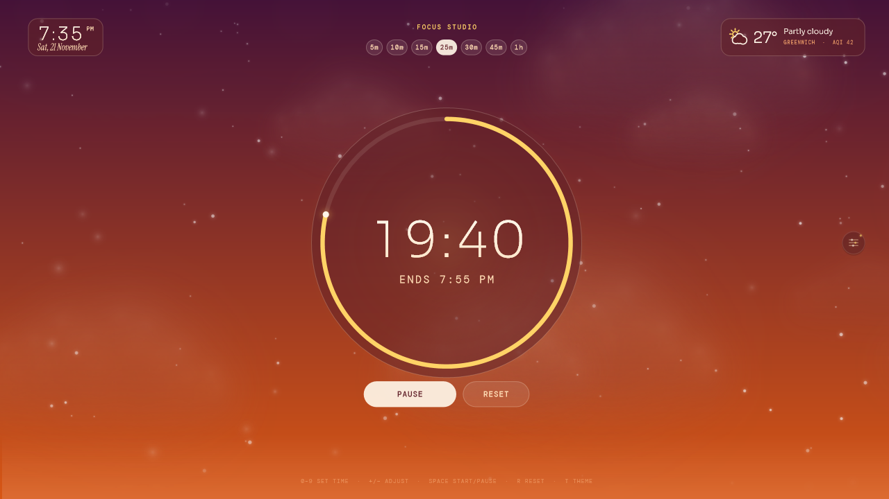
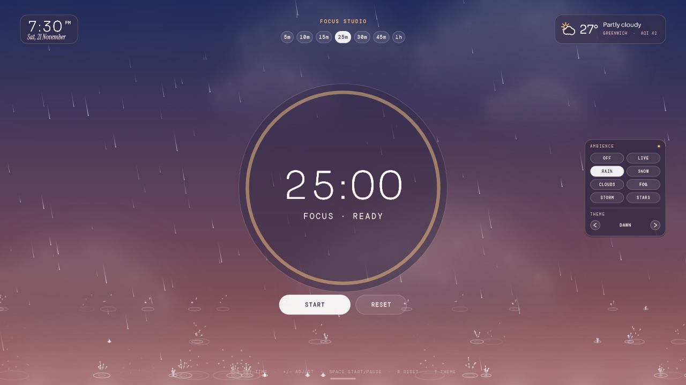

# Meridian — 2.9.7 "Snowfall" (Sonnet Edition)

**A quiet, always-on clock, live sky map, weather studio, and focus sanctuary for Windows.**

Meridian is a native, single-file Windows desktop clock and screen saver written in C++17 with Direct2D and DirectWrite — no browser engine, no Electron runtime, and zero external DLL dependencies.


---

## Highlights in 2.9.7 "Snowfall"

- **Six Distinct Faces (`1`–`6`)**
  - **Sky (`1`)** — Big display clock, live astronomical sky dome (Sun, Moon, planets, stars, constellations, Milky Way, eclipses, and shooting stars), rotating Today / Events / Holidays / World Clocks panel, and live weather with a custom Air Quality badge.
  - **Quiet (`2`)** — Minimalist full-screen typography with live weather drawn calmly behind the clock (clouds, wind, rain, layered snowfall, fog, thunder, and named tropical storm watch).
  - **Timer (`3`)** — Clean countdown timer, stopwatch with laps, and desk alarm.
  - **Almanac (`4`)** — Detailed Sun & Moon telemetry, exact morning & evening **Golden Hour** and **Blue Hour** spans, planetary visibility, and 7-day forecast.
  - **Widgets (`5`)** — Modular pages for World Clocks (31 cities with per-year Windows Dynamic DST), Month Calendar, Moon Phases, Hourly Forecast, Daylight, Sky, Air Quality, System stats, Countdown, and Notes.
  - **Focus Studio (`6`)** — Dedicated lo-fi focus sanctuary with its own independent Pomodoro timer (`25m` default), smaller live clock & weather corner cards, frosted focus medallion with breathing halo, and a **collapsible floating Ambience & Theme orb** (`Off · Live · Rain · Snow · Clouds · Fog · Storm · Stars`) that expands smoothly on hover and stays completely out of the way while you work.




- **Layered Snowfall & Shooting-Star Physics**
  - Calm three-depth snowfall behind both the Quiet and Sky faces (plus a `SNOW` preview chip in **Settings → Quiet**).
  - Midnight meteors ignite from a pinpoint, flare with warm-to-white color temperature and shedding sparks, and stream in a weekly alternating 6-week directional loop.
- **Daylight Saving Time (DST Zones Only)**
  - Automatic 2 AM DST transitions, per-hour DST-accurate forecasts, subtle `DST` header tag only when DST is active, 48-hour clock-change Today notices, and Windows Dynamic DST across World Clock cities — leaving non-DST zones completely untouched.
- **Resilient Weather & Multi-Source Air Quality**
  - **8 weather providers** tried in fallback order: **Open-Meteo**, **MET Norway**, **wttr.in**, **7Timer**, **Bright Sky (DWD)**, **NWS / NOAA**, plus optional free-key **WeatherAPI.com** and **OpenWeatherMap** in **Settings → Weather**.
  - Independent **4-tier Air Quality pipeline** (**Open-Meteo Air Quality → WeatherAPI.com → OpenWeatherMap → WAQI nearby station**) with a color-coded air-waves emblem badge on Sky and Focus.
  - Hardened WinHTTP networking with generous timeouts, forecast/AQI staggering, and automatic TLS 1.2 + HTTP/1.1 fallback recovery.
- **Ten Built-In Themes + Custom Theme Packs**
  - `Auto`, `Day`, `Sunlit`, `Sunlit II`, `Dawn`, `Sunset`, `Dusk`, `Night`, `Midnight`, and `Ember` (plus optional red-night bedtime mode and drop-in JSON/art Theme Packs in `themes/`).
- **Screen Saver Mode & Privacy-First Defaults**
  - Includes `Install-ScreenSaver.bat` / `Remove-ScreenSaver.bat` and a full standalone Windows installer (`Meridian-Setup-2.9.7.exe`).
  - Defaults cleanly to the Prime Meridian (Greenwich) with Celsius & km/h units. Optional API keys and settings stay strictly local in `settings.ini`.

---

## Download & Install (Windows)

Grab the latest binaries from the [**Releases**](../../releases) page:

| File | Description |
| :--- | :--- |
| **`Meridian-Setup-2.9.7.exe`** | Recommended Windows installer with Start Menu shortcut, optional startup & screen saver setup, and transactional rollback-safe upgrades. |
| **`Meridian-2.9.7.zip`** | Portable ZIP — unzip anywhere and run `Meridian.exe`. |
| **`Meridian.exe`** | Standalone single-file executable (Windows 10 / 11, 64-bit). |

---

## Keyboard Shortcuts

| Key | Action |
| :--- | :--- |
| `1` – `6` | Switch face (`Sky`, `Quiet`, `Timer`, `Almanac`, `Widgets`, `Focus`) |
| `T` / `Shift+T` | Next / previous theme |
| `F` or `F11` | Toggle fullscreen |
| `P` | Toggle keep on top |
| `Space` / `R` | Start/pause or reset on Timer & Focus |
| `,` | Open Settings |
| `F1` or `?` | Show all shortcuts |
| `Esc` | Close overlay, dismiss alert, or exit fullscreen |

---

## Building from Source

Meridian compiles to a static, dependency-free 64-bit Windows executable with **MinGW-w64** (`g++` C++17) and **Python 3** (for packing the setup wizard).

### Windows (MSYS2 MINGW64 or w64devkit)
```bat
:: Build Meridian.exe (release)
set MERIDIAN_WERROR=1
build.bat

:: Build Meridian-Setup-2.9.7.exe (installer)
cd setup
build-setup.bat
```

### Linux Cross-Compile (Ubuntu / Debian)
```bash
sudo apt-get install -y mingw-w64 python3

# Build release Meridian.exe
MERIDIAN_WERROR=1 ./build.sh

# Build Windows installer
MERIDIAN_WERROR=1 ./setup/build.sh

# Run portable unit test suite (ASan + UBSan)
bash tests/run_all.sh
```

> **Development build:** Set `MERIDIAN_DEV=1` before running `build.bat` or `./build.sh` to build `build-dev/Meridian-dev.exe` with off-screen screenshot (`--shot`) and benchmark (`--bench`) switches without overwriting release `Meridian.exe`.

---

## Continuous Integration

Pushing this repository to GitHub automatically runs [`.github/workflows/build.yml`](.github/workflows/build.yml):
1. **`portable-tests`** — Runs all 18 C++ unit tests on Ubuntu with AddressSanitizer and UndefinedBehaviorSanitizer.
2. **`cross-build`** — Cross-compiles release `Meridian.exe`, dev `Meridian-dev.exe`, and `Meridian-Setup-2.9.7.exe` with `-Werror` and verifies no dev flags leak into the release binary.
3. **`windows-build`** — Compiles natively on `windows-latest` with MSYS2 MinGW-w64 (`build.bat` & `setup\build-setup.bat`).
4. **`wine-smoke`** — Renders every face, theme, and Settings tab off-screen under Wine.

---

## Licenses & Credits

- Bundled open-source fonts (`Sora`, `Instrument Serif`, `DM Mono`, `Anton`) are licensed under the SIL Open Font License 1.1 — see [`licenses/`](licenses/).
- Full documentation and complete version history from 1.x through 2.9.7 are in [`README.txt`](README.txt).
