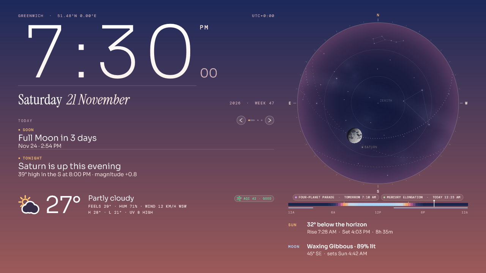

# Meridian — 2.9.9 "Nimbus" (Sonnet Edition)

**A quiet, always-on clock, live sky map, weather studio, and focus sanctuary for Windows.**

Meridian is a native, single-file Windows desktop clock and screen saver written in C++17 with Direct2D and DirectWrite — no browser engine, no Electron runtime, and zero external DLL dependencies.



---

## Highlights in 2.9.9 "Nimbus"

- **Sculpted Volumetric Clouds, Cinematic Atmospheric Fog & Four New Artistic Weather Effects**
  - **Remade Volumetric Clouds** — Replaces flat circle puffs with three sky-altitude archetypes painted with smooth directional elliptical gradients (zero polka-dot artifacts): sweeping feathered **cirrus wisps**, asymmetric cauliflower **cumulus towers** with flat shadowed bases and crisp sunlit/moonlit crown rims, and dramatic **stratocumulus decks** sorted cleanly back-to-front across all 10 built-in themes, plus a layered storm canopy and an ethereal feathered foreground cloud veil.
  - **Remade Cinematic Atmospheric Fog** — Four-tone layered valley mist with luminous contrast on both dark and light themes: diffused upper-sky atmospheric light bloom, three sculpted rolling mist-bank sprites with cool troughs beneath bright crests, counter-drifting thermal depth strata, slow curling gossamer mist tendrils, floating dew-light micro-motes, and a whisper-soft foreground mist veil.
  - **Four Brand-New Artistic Weather Systems** — **Drizzle** (ultra-fine misty rain veil with delicate ground ripples & damp haze), **Sleet** (brisk translucent ice-beaded freezing streaks interwoven with tumbling wet snowflakes & icy ground flecks), **Hail** (faceted glacier-lit ice stones with kinetic two-hop parabolic ground bounces & crystalline shard sparks), and **Gale** (sweeping double-curled storm ribbons, aerodynamic gust-shear mist plumes, motion-streaked spray & swirling leaf whirlwinds). All four auto-trigger from live weather codes & gusts, fall cleanly behind the Sky map (for precipitation), preview in **Settings → Quiet**, and join the **Focus Studio** Ambience Orb (now 14 studio backdrops, including **Midnight** alongside **Stars**).
  - **Galaxy Theme & Brand-New Artistic Midnight Theme** — The deep-space cosmos theme (Milky Way, emission nebulae, Andromeda, ringed Saturn, meteors, comet & `U`-key UFO visitor) is now named **Galaxy**, joined by a brand-new handcrafted **Midnight** theme: velvety Prussian-indigo to moonlit cerulean horizon, moon-pearl typography, champagne-gold & cerulean accents, frosted sapphire-crystal surfaces, subtle lunar airglow, and crisp zenith stars crafted to flatter every face and every weather effect.
- **Liquid Glass Tactile UI Everywhere, Artistic Blizzard & Deep-Space Cosmos**
  - Every button across **Timer**, **Focus Studio**, the **bottom navigation dock**, rotating panel arrows, Month Calendar arrows, and **Settings** (including liquid-droplet gliding toggles and frosted `−`/`+` steppers) features spring-eased hover bloom, cursor-tracking specular glass sheen, tactile press-and-hold squish, elastic liquid-jelly rebound, and expanding caustic click ripples — plus **gliding active pills** across segmented rows and touch-reactive Focus Studio cards & Sky AQI badge.
  - **Artistic Blizzard / Harsh Snowstorm** — four organic blowing-snow variants across three parallax depths, billowing whiteout squall curtains, curling frosted spindrift wind ribbons, racing ground snowdrifts, and fast foreground wisps.
  - **Remade Deep-Space Cosmos (`Midnight` & Focus `STARS`)** — sculpted Milky Way with Great Dark Rift, organic multi-cloud emission nebulae, ~1,400 spectral O–M stars with 4-point diffraction starbursts, Pleiades cluster, feathered spiral Andromeda + companion dwarf galaxy, tilted banded Saturn with Cassini Division & moons, crescent ice-giant, 44 living jewel stars, and weather-immune dual meteor streams & comets in Focus `STARS`.
  - Runs at full display refresh rate during interaction and settles completely back to **1 FPS idle** with zero background CPU/GPU cost.

- **Six Distinct Faces (`1`–`6`)**
  - **Sky (`1`)** — Big display clock, live astronomical sky dome (Sun, Moon, planets, stars, constellations, Milky Way, eclipses, and shooting stars), rotating Today / Events / Holidays / World Clocks panel, and live weather with a custom Air Quality badge.
  - **Quiet (`2`)** — Minimalist full-screen typography with live weather drawn artistically behind the clock (sculpted clouds, cinematic fog, wind, gale, drizzle, rain, sleet, hail, snowfall, blizzard, thunder, tornado, sun flare, and named tropical storm watch).
  - **Timer (`3`)** — Clean countdown timer, stopwatch with laps, and desk alarm.
  - **Almanac (`4`)** — Detailed Sun & Moon telemetry, exact morning & evening **Golden Hour** and **Blue Hour** spans, planetary visibility, and 7-day forecast.
  - **Widgets (`5`)** — Modular pages for World Clocks (31 cities with per-year Windows Dynamic DST), Month Calendar, Moon Phases, Hourly Forecast, Daylight, Sky, Air Quality, System stats, Countdown, and Notes.
  - **Focus Studio (`6`)** — Dedicated lo-fi focus sanctuary with its own independent Pomodoro timer (`25m` default), smaller live clock & weather corner cards, frosted focus medallion with breathing halo, and a **collapsible floating Ambience & Theme orb** (`Off · Live · Drizzle · Rain · Storm · Hail · Sleet · Snow · Blizzard · Gale · Clouds · Fog · Stars`) that expands smoothly on hover (paired with a matching **fluid liquid-glass pill-to-dock morph** on the bottom navigation bar across every face).


- **42-Constellation Artistic Sky Atlas, Layered Snowfall & Shooting-Star Physics**
  - Natural compass Sky Map orientation (`N` up, `E` right, `S` down, `W` left), true dark cosmic Midnight/Night/Ember dome palettes, and **42 accurate J2000 constellations** across both hemispheres with real spectral star colors, trimmed filigree lines, and diamond glints — appearing strictly at night by default (even on dark themes), with an optional daytime toggle in **Settings → Sky Map**.
  - Calm three-depth snowfall behind both the Quiet and Sky faces (plus a `SNOW` preview chip in **Settings → Quiet**).
  - Midnight meteors ignite from a pinpoint, flare with warm-to-white color temperature and shedding sparks, and stream in a weekly alternating 6-week directional loop.
- **Daylight Saving Time (DST Zones Only)**
  - Automatic 2 AM DST transitions, per-hour DST-accurate forecasts, subtle `DST` header tag only when DST is active, 48-hour clock-change Today notices, and Windows Dynamic DST across World Clock cities — leaving non-DST zones completely untouched.
- **Resilient Weather & Multi-Source Air Quality**
  - **8 weather providers** tried in fallback order: **Open-Meteo**, **MET Norway**, **wttr.in**, **7Timer**, **Bright Sky (DWD)**, **NWS / NOAA**, plus optional free-key **WeatherAPI.com** and **OpenWeatherMap** in **Settings → Weather**.
  - Independent **4-tier Air Quality pipeline** (**Open-Meteo Air Quality → WeatherAPI.com → OpenWeatherMap → WAQI nearby station**) with a color-coded air-waves emblem badge on Sky and Focus.
  - Hardened WinHTTP networking with generous timeouts, forecast/AQI staggering, and automatic TLS 1.2 + HTTP/1.1 fallback recovery.
- **Eleven Built-In Themes + Custom Theme Packs**
  - `Auto`, `Day`, `Sunlit`, `Sunlit II`, `Dawn`, `Sunset`, `Dusk`, `Night`, `Midnight`, `Galaxy`, and `Ember` (plus optional red-night bedtime mode and drop-in JSON/art Theme Packs in `themes/`).
- **Screen Saver Mode & Privacy-First Defaults**
  - Includes `Install-ScreenSaver.bat` / `Remove-ScreenSaver.bat` and a full standalone Windows installer (`Meridian-Setup-2.9.9.exe`).
  - Defaults cleanly to the Prime Meridian (Greenwich) with Celsius & km/h units. Optional API keys and settings stay strictly local in `settings.ini`.

---

## Download & Install (Windows)

Grab the latest binaries from the [**Releases**](../../releases) page:

| File | Description |
| :--- | :--- |
| **`Meridian-Setup-2.9.9.exe`** | Recommended Windows installer with Start Menu shortcut, optional startup & screen saver setup, and transactional rollback-safe upgrades. |
| **`Meridian-2.9.9.zip`** | Portable ZIP — unzip anywhere and run `Meridian.exe`. |
| **`Meridian.exe`** | Standalone single-file executable (Windows 10 / 11, 64-bit). |

---

## Keyboard Shortcuts

| Key | Action |
| :--- | :--- |
| `1` – `6` | Switch face (`Sky`, `Quiet`, `Timer`, `Almanac`, `Widgets`, `Focus`) |
| `T` / `Shift+T` | Next / previous theme |
| `F` or `F11` | Toggle fullscreen |
| `P` | Toggle keep on top |
| `Space` / `R` | Start/pause or reset on Timer & Focus |
| `,` | Open Settings |
| `F1` or `?` | Show all shortcuts |
| `Esc` | Close overlay, dismiss alert, or exit fullscreen |

---

## Building from Source

Meridian compiles to a static, dependency-free 64-bit Windows executable with **MinGW-w64** (`g++` C++17) and **Python 3** (for packing the setup wizard).

### Windows (MSYS2 MINGW64 or w64devkit)
```bat
:: Build Meridian.exe (release)
set MERIDIAN_WERROR=1
build.bat

:: Build Meridian-Setup-2.9.9.exe (installer)
cd setup
build-setup.bat
```

### Linux Cross-Compile (Ubuntu / Debian)
```bash
sudo apt-get install -y mingw-w64 python3

# Build release Meridian.exe
MERIDIAN_WERROR=1 ./build.sh

# Build Windows installer
MERIDIAN_WERROR=1 ./setup/build.sh

# Run portable unit test suite (ASan + UBSan)
bash tests/run_all.sh
```

> **Development build:** Set `MERIDIAN_DEV=1` before running `build.bat` or `./build.sh` to build `build-dev/Meridian-dev.exe` with off-screen screenshot (`--shot`) and benchmark (`--bench`) switches without overwriting release `Meridian.exe`.

---

## Continuous Integration

Pushing this repository to GitHub automatically runs [`.github/workflows/build.yml`](.github/workflows/build.yml):
1. **`portable-tests`** — Runs all 18 C++ unit tests on Ubuntu with AddressSanitizer and UndefinedBehaviorSanitizer.
2. **`cross-build`** — Cross-compiles release `Meridian.exe`, dev `Meridian-dev.exe`, and `Meridian-Setup-2.9.9.exe` with `-Werror` and verifies no dev flags leak into the release binary.
3. **`windows-build`** — Compiles natively on `windows-latest` with MSYS2 MinGW-w64 (`build.bat` & `setup\build-setup.bat`).
4. **`wine-smoke`** — Renders every face, theme, and Settings tab off-screen under Wine.

---

## Licenses & Credits

- Bundled open-source fonts (`Sora`, `Instrument Serif`, `DM Mono`, `Anton`) are licensed under the SIL Open Font License 1.1 — see [`licenses/`](licenses/).
- Full documentation and complete version history from 1.x through 2.9.9 are in [`README.txt`](README.txt).
